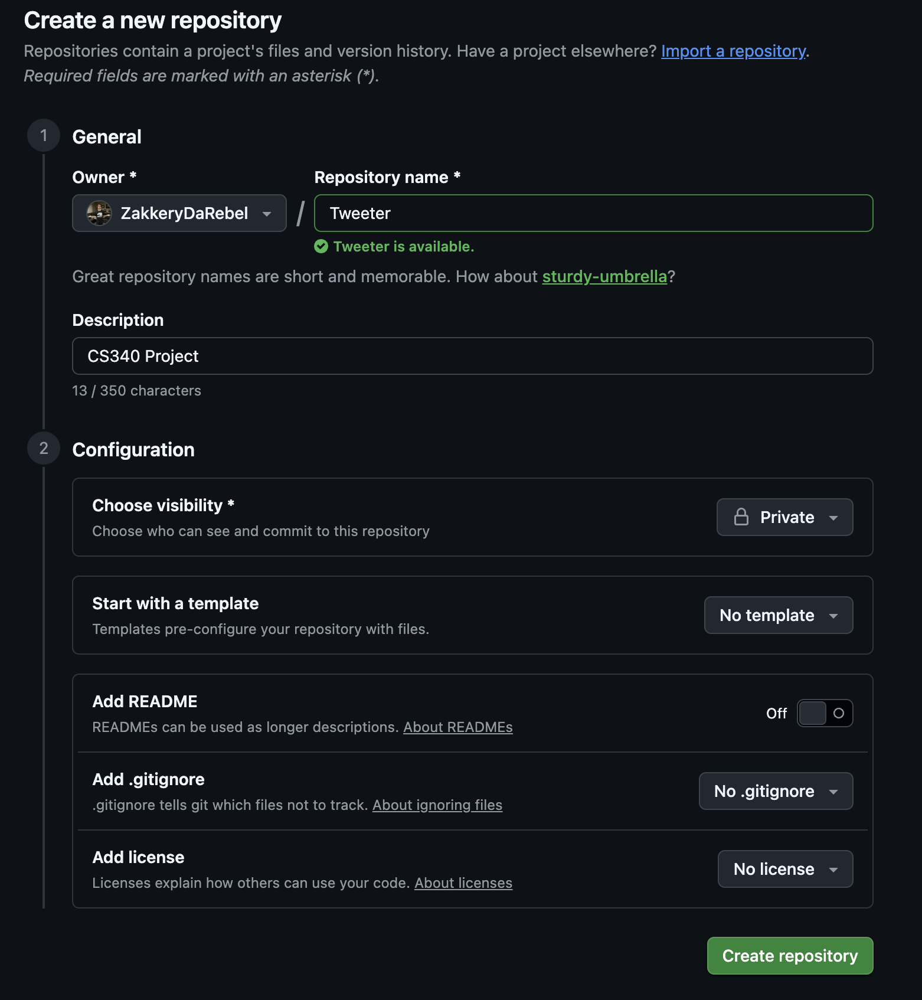
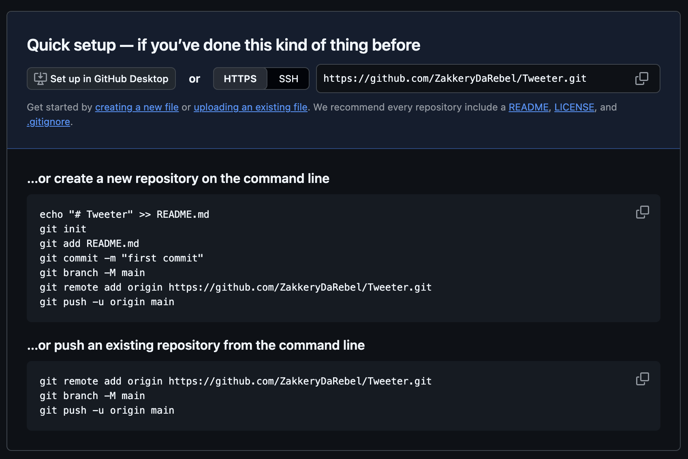

# How to get your Tweeter Project up on Github

After you have downloaded the project zip folder, unzipped it, and put it in the parent directory you want it to go, go to your GitHub account and create a new repository.

When creating a new repository:

- Name the repository whatever you want, `Tweeter` is good
- Set the visibility to Private, sharing your repository is a violation of the Honor Code
- Turn off the setting to add a README.md file
- Click on `Create repository`

Now with your repository created, you should see some instructions on how to connect your downloaded Tweeter code to this repository in the section titled `...or create a new repository on the command line`

This will help you turn your Tweeter folder on your local machine into a GitHub repository that is connected to this repository you just created.

Now you have your code all set up. If you refresh your page, you should see that you added a README file or added a new line to your README file, and you are all set up to commit, push, and most importantantly save your work.
